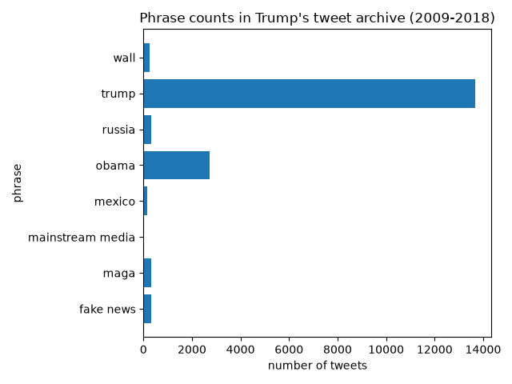

# [lab-web-data](https://csci40.rtealwitter.com/topics/05_web_scraping/lab.html)

## Tweet phrase analysis

Across all 35402 tweets in the archive (2009-2018), here is how often each
phrase appears (ignoring capitalization, counting a tweet once per phrase
even if it repeats):

| phrase           | percent of tweets |
| ---------------- | ----------------- |
|        fake news | 00.88             |
|             maga | 00.93             |
| mainstream media | 00.03             |
|           mexico | 00.45             |
|            obama | 07.73             |
|           russia | 00.91             |
|            trump | 38.58             |
|             wall | 00.68             |

I predicted "wall" would be the most common of my three chosen phrases
(wall, maga, mainstream media), but "maga" edged it out (330 tweets vs. 242),
while "mainstream media" was by far the rarest phrase in the whole dataset.
